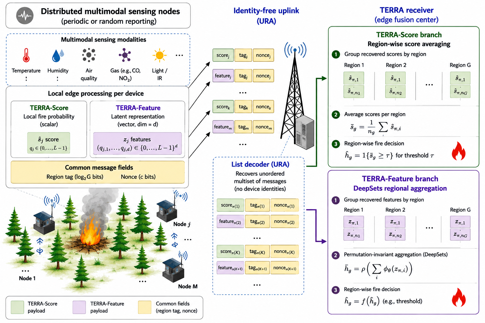

# TERRA

Code and experimental results for:

**TERRA: Task-Oriented Edge AI for Regional Fire Detection with Identity-Free Reporting**
Mohammad Kazemi and Julie A. McCann
Imperial College London
Accepted at **IoT '26 — International Conference on the Internet of Things**, Newcastle upon Tyne, UK, November 17–20, 2026.

<p align="center">
  
</p>

TERRA (**Task-Oriented Edge Representation and Regional Aggregation**) is an edge-AI framework for distributed sensing in which devices communicate compact task-relevant reports without persistent device identities. Reports are grouped by geographic region and aggregated to produce regional event decisions.

The repository accompanies the fire-detection proof-of-concept evaluation reported in the paper.

## TERRA reporting modes

TERRA supports two complementary reporting modes:

- **TERRA-Score:** each device communicates a quantized local fire probability.
- **TERRA-Feature:** each device communicates a compact learned feature vector that is aggregated at the receiver using a permutation-invariant DeepSets model.

A **Handcrafted-Stats** representation based on temporal sensor statistics is included as a nonlearned benchmark.

The experiments use all 15 numerical sensing modalities available in the distributed indoor EN54 fire-alarm dataset.

## Main results

Under perfect message recovery with nine available reports per region:

| Method | Report dimension | Task bits/report | AUPRC | MDR @ FAR ≤ 1% |
|---|---:|---:|---:|---:|
| TERRA-Score | 1 | 6 | 0.9868 | 1.81% |
| TERRA-Feature | 4 | 24 | 0.9896 | 1.81% |
| Handcrafted-Stats | 30 | 30 | 0.9713 | 11.42% |

The repository also contains the message-recovery sensitivity study over missed-detection and false-alarm probabilities. The experiment uses a synthetic address space of 16 valid region tags and evaluates 90 \((P_{\mathrm{MD}},P_{\mathrm{FA}})\) operating points.

Task-bit counts above refer only to the task payload; region-tag and nonce overhead are treated separately in the system model.

## Repository structure

```text
configs/
    paper/          Final configurations for the reported TERRA experiments
    ablations/      Supporting representation/ablation configurations

data/
    raw/en54/       Location for the externally downloaded EN54 dataset
    processed/      Compact dataset/schema metadata

fire_ura/           Core Python package

scripts/            Training, ablation, quantization, and URA experiments

paper_results/      Compact numerical results used in the paper

figures/            Final paper figures and plotting scripts

tests/              Unit and pipeline tests
```

Full training runs, checkpoints, intermediate arrays, and the raw EN54 dataset are intentionally not stored in the repository.

## Installation

Python 3.10 or later is required.

From the repository root:

```bash
python -m pip install -e ".[dev]"
```

## Dataset

The experiments use the **Indoor Fire Dataset with Distributed Multi-Sensor Nodes (EN54 Test Room)**.

Download:

`indoor_fire_detection_multisensornodes_dataset.csv`

and place it at:

```text
data/raw/en54/indoor_fire_detection_multisensornodes_dataset.csv
```

The raw dataset is not redistributed in this repository.

Dataset DOI: **10.17632/npk2zcm85h.2**

## Tests

Run:

```bash
python -m pytest tests -q --basetemp=.pytest_tmp
```

The public-release code passes the complete test suite.

## Reproducing the main learned pipeline

Train the selected four-dimensional sensor representation:

```bash
python scripts/run_sensor_cv.py --config configs/paper/sensor_cv_all15_d4.yaml
```

Build the corresponding regional dataset:

```bash
python scripts/build_region_dataset.py --config configs/paper/region_cv_all15_d4.yaml
```

Train the regional DeepSets receiver:

```bash
python scripts/run_region_cv.py --config configs/paper/region_cv_all15_d4.yaml
```

The supporting scripts in `scripts/` reproduce the representation-dimension study, handcrafted-statistics ablation, task-payload quantization study, and synthetic URA message-recovery sensitivity study.

## Reproducing the paper figures from released results

The compact result tables required for the main communication figures are included under `paper_results/`.

Figure 2:

```bash
python figures/plot_fig2_payload_reports_d4.py --output-stem figures/fig2_payload_reports_d4 --formats pdf
```

Figure 3:

```bash
python figures/plot_fig3_ura_robustness_d4.py --output-stem figures/fig3_ura_robustness_d4 --formats pdf
```

These plotting scripts operate directly on the released aggregate result files and do not require retraining the models.

## Experimental scope

The EN54 dataset is used as a controlled indoor proof-of-concept testbed for distributed regional inference. The experiments do not constitute direct validation of an outdoor wildfire deployment.

The URA robustness study operates at the recovered-list level through prescribed missed-detection and false-alarm probabilities; it does not simulate a particular physical-layer code, SNR, or blocklength.

## Citation

If you use this code or results, please cite:

```bibtex
@inproceedings{kazemi2026terra,
  author    = {Mohammad Kazemi and Julie A. McCann},
  title     = {TERRA: Task-Oriented Edge AI for Regional Fire Detection with Identity-Free Reporting},
  booktitle = {International Conference on the Internet of Things (IoT '26)},
  year      = {2026},
  address   = {Newcastle upon Tyne, United Kingdom}
}
```

The DOI and final ACM bibliographic information will be added once available.